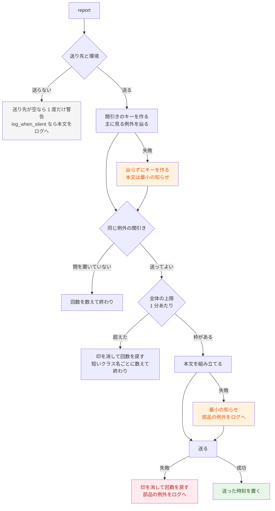

# 設計書

この部品は、Laravel が記録する例外を Chatwork の部屋に知らせる。知らせの役目は「どんな種類の例外かを知らせ、ログを引く鍵（Request ID）を渡す」こと。伏せる前の文言・SQL・呼び出しの並びは、Laravel がいつもどおりログに書く。

本文の形は [message-format.md](message-format.md)、伏せる規則は [redaction.md](redaction.md) にある。

## 入口

| 入口 | 何が呼ぶか | 中身 |
| --- | --- | --- |
| `Reporter::report(Throwable)` | ServiceProvider が `Handler::reportable()` に登録した関数 | 記録する例外（`dontReport` に当たらない物）を送る。void を返すので、Laravel の元の記録は止まらない |
| `Reporter::notice(title, lines, key, code)` | 使う側のコード | 例外ではない知らせを送る |
| `Reporter::body(Throwable)` | `log_when_silent` とテスト | 本文だけを作る（間引きの行は無し） |
| キューのイベント 4 つ | ServiceProvider が登録 | ジョブの入口の印と Request ID の入れ替え（`JobEntrance`） |

## 処理の流れ（report）



`notice` も同じ流れで、間引きのキーは使う側が渡したキーから作る（辿る処理は無い）。

## 本文の組み立て（compose）

1. **主に見る例外を決める**（`Chain`）。previous を最大 10 段辿り、外側から包む例外（既定 `ViewException`）を剥ぐ。剥いだ物は「包んだもの」、内側は「原因」（3 つまで）になる
2. **種類ごとの部分を取る**（`Details` → `Kind`）。件名の要約と「種類」の行の項目
3. **メッセージを作る**。形の分かる例外は組み立て直す（`KnownMessage`）。それ以外は `send_message` のときだけ元の文言を伏せる（`Redactor`）
4. **アプリの行を決める**（`Source::appLine`）。前後のコードは `snippet_paths` の中だけ読む（`Snippet`）
5. **入口を決める**。ジョブ → コマンド → HTTP の順（`JobEntrance`・`Reporter::entrance`）
6. **呼び出しの並び**（`Trace`、アプリの段を 10 段まで）
7. **並べる**（`Body`）。30,000 文字を超えたら、呼び出しの並び → 前後のコードの順に塊で落とす

本文に入る値は、項目ごとに `Text::field()` を通す。順番を入れ替えると壊れる。

```text
文字を直す（不正な UTF-8・制御文字）→ 伏せる → 記法を逃がす → 表示幅で切る
```

伏せる前に逃がすと規則の当たり方が変わり、切った後に逃がすと幅を超える。伏せる処理が失敗したら、その項目を「（伏せられなかったので省いた。ログを見る）」にする。

## クラスの受け持ち

| クラス | 受け持ち |
| --- | --- |
| `RichChatworkServiceProvider` | 設定の読み込み・登録・`reportable()` とキューのイベントの登録 |
| `Reporter` | 入口。送るかの判断・間引き・上限・組み立て・送る・失敗したときの動き |
| `Chain` | previous のつながり。主に見る例外・包んだもの・原因・包んだビュー |
| `Details` / `Kind` | 例外の種類ごとの、値を含まない部分（件名の要約と項目） |
| `KnownMessage` | 形の分かる例外（DB・HTTP クライアント）の文言を組み立て直す |
| `DriverMessage` | DB のドライバーの文言の許可リスト |
| `Redactor` | 伏せる規則（文言・notice・前後のコード・リクエスト） |
| `Text` | 値の通し方（直す・逃がす・切る）と、失敗を null で返す置き換え |
| `Names` | クラス名・関数名の整形（匿名クラス・クロージャのパス、件名の短い名前） |
| `Source` / `AppLine` | アプリのパスの見分け（vendor・コンパイル済みのビュー）、アプリの行 |
| `Snippet` | 前後のコード |
| `Trace` | 引数の値を含まない呼び出しの並び |
| `JobEntrance` | ジョブの入口の印、Request ID の退避と戻し、失敗のイベントで入口を例外に結び付ける |
| `Throttle` | 同じ例外の間引き・送らなかった回数・全体の上限 |
| `Body` | 本文の並び（地の文・枠・横線）と塊での落とし方 |
| `Settings` | 設定を型を決めて読む |
| `Transport` / `PhpChatworkTransport` / `TimeoutMessage` | 送るところ。php-chatwork にタイムアウトを付けた物 |

## ゴールと仕組みの対応

ゴールは [README](../README.md#ゴール重要順) の表。ぶつかったら上を取る（[0006](decisions/0006-goals-in-order.md)）。

| ゴール | 主な仕組み | 場所 |
| --- | --- | --- |
| 1 黙殺しない | 最小の知らせ・送信の失敗で印を消す・失敗をログへ・送り先が空の警告・`reportable()` から投げない | `Reporter`・`Throttle` |
| 2 秘密を出さない | 組み立て直す（許可リスト）・伏せる規則・接続先を出さない・引数の値を出さない | `KnownMessage`・`DriverMessage`・`Redactor`・`Trace` |
| 3 個人情報を出さない | 文言は既定で送らない・メール・電話番号・マイナンバー・口座番号を伏せる・利用者は内部 ID だけ | `Redactor`・`Reporter` |
| 4 種類が分かり、ログを引ける | 件名の要約・Request ID・ジョブの新しい ID と発端の ID | `Details`・`JobEntrance` |
| 5 誤って判断しない | アプリの行（TypeError は呼び出し側）・入口の順・回数と時刻（アプリのタイムゾーン） | `Source`・`Reporter` |
| 6 部屋を壊さない | 記法の逃がし・項目と全体の長さ・同じ例外の間引き・全体の上限 | `Text`・`Body`・`Throttle` |
| 7 使う側を壊さない | 公開の口と設定のキーを保つ。型の違う設定は既定に戻す | `Settings`・[CHANGELOG](../CHANGELOG.md) |

## 失敗したときの動き（ゴール 1）

| 起きたこと | 動き | ログに書く物 |
| --- | --- | --- |
| 起動の途中で設定が読めない | 何もしない | なし（Laravel の元の記録は続く） |
| 伏せる処理が失敗（正規表現の誤り・上限） | その項目だけ省き、送る | なし |
| 間引きのキーを作れない | 外側の例外のクラスと投げた場所でキーを作り、最小の知らせを送る | 部品の例外（生）・元の例外のクラス・Request ID |
| 本文を組み立てられない | 最小の知らせ（件名と Request ID だけ）を送る | 同上 |
| 送れない（Chatwork の障害・タイムアウト） | 間引きの印を消し、回数と上限の件数を戻す | 同上 |
| キャッシュが投げる | その知らせの間はプロセスの中だけで間引く（回数の行は出さない） | なし |
| 全体の上限を超えた | 送らず、短いクラス名ごとに数えて次の知らせに足す | なし（元の例外はログにある） |
| 送る環境で送り先が空 | 送らず、プロセスごとに 1 度だけ警告 | 警告 |
| ログにも書けない | 諦める | — |

「部品の例外を生で」は、`Log::warning()` の文脈の `exception` に部品の例外のオブジェクトを渡すこと（文言と呼び出しの並びが残る）。元の例外の文言と本文は渡さない（元の例外は Laravel が別に書く）。

## ジョブの入口と Request ID

```text
JobProcessing   Laravel の ContextServiceProvider が Context を payload の物に入れ替える（hydrate）
                → 部品が前の Request ID を積み重ねに退避し、ジョブ用の新しい ID を入れる
ジョブの中      ログは新しい ID で書かれる
失敗のイベント  JobExceptionOccurred か JobFailed（Worker は試行回数を超えると JobFailed が先）
                → 入口（ジョブの名前・ID・発端の ID）を例外に結び付けて取っておき、1 段戻す
report()        Laravel は失敗のイベントの後で呼ぶ。結び付けた入口を Context より先に見る
JobProcessed    成功したら 1 段戻す
```

- 戻すのはジョブごとに 1 回だけ（uuid で見分ける）。sync の入れ子では一番内側の入口を残す
- 部品の JobProcessing は ContextServiceProvider より後に動く必要がある。パッケージの ServiceProvider は Laravel の基本の ServiceProvider より後に boot されるので満たしている（`JobEntranceTest` で固定）
